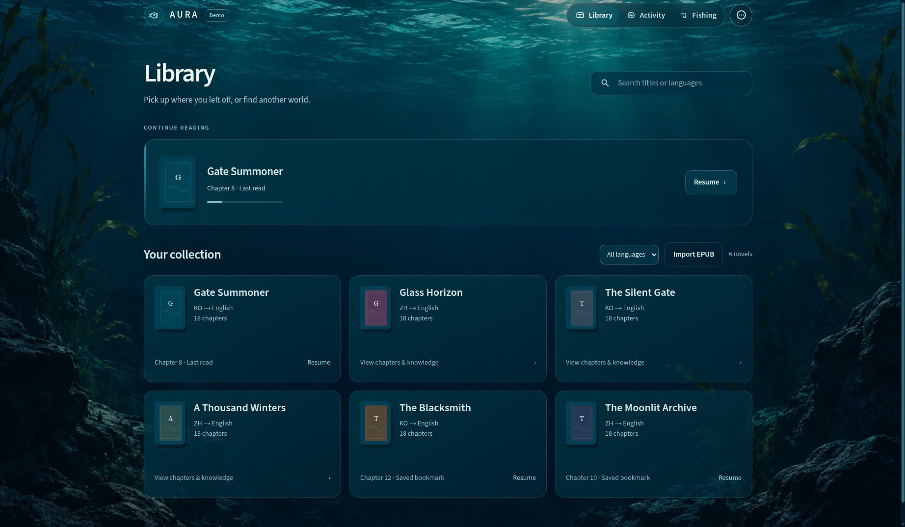
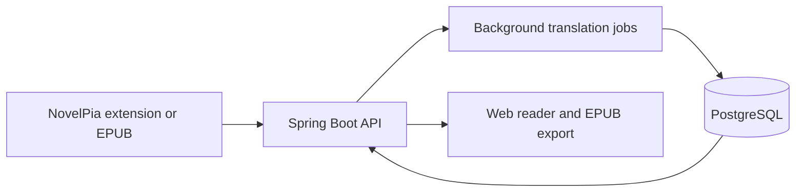

# Aura Platform

Aura is a self-hosted platform for importing, translating, and reading web novels. Functionality includes browser and EPUB imports, background translation jobs, a web reader, and PocketBook delivery. 

As of November 2026, my instance held English translations of **1,275 chapters across 39 novels**: 992 chapters translated from Korean and 283 from Chinese. Additionally, in the latest version **36 PocketBook deliveries across 10 novels** have also been recorded.

This repository is a public showcase. The current implementation is maintained privately.

*Library shown in Demo mode with sample titles and covers.*

[View the product walkthrough](docs/showcase.md) for screenshots from the running instance, including model comparison and a confirmed PocketBook delivery.

## Main functionalities 

- **Import.** Bring chapters in from NovelPia through a browser extension or from other sources through an EPUB. Aura stores the source separately from its translation and preserves content structure such as paragraphs and inline images.
- **Translate.** Queue individual chapters or batches of chapters. The Activity Center shows job progress (translations, re-translations, exports, imports) and failures and lets you retry failed work.
- **Read and export.** Switch between the original and English text, adjust typography, and navigate by chapter. Export translated chapters as an EPUB for reading on a PocketBook.

## Backend design

**Translation context.** Aura Intelligence maintains a glossary and character information for each novel. When translating a chapter Aura selects relevant names, aliases, and pronoun guidance from intelligence context so recurring terms and characters can stay consistent across chapters.

**Job recovery.** Completed translation sections are stored in PostgreSQL. If work is interrupted, a resumed job can reuse saved sections and retry failed chapters. It also makes sure a stale attempt cannot overwrite a completed translation.

**Model evaluation.** Aura’s LLM provider comparison tool runs models on the same chapters and records latency, API cost, and output validation failures. I used it to evaluate **four model configurations across 22 chapter runs**, including repeated runs and baselines.

## Stack and testing

The backend uses **Java 21, Spring Boot, PostgreSQL, and Flyway**. The reader uses **React and TypeScript**, and **Docker Compose** runs the application and database together. Backend integration tests cover source import, recovery after interruption, and protection against stale writes.

## Earlier demos

These videos show previous builds. The sections above describe the current private implementation.

- [v0.1 — First end-to-end prototype](https://youtu.be/QLzIz7I3g-s) — Browser import, Gemini translation, the original web reader, and EPUB export to PocketBook.
- [Earlier development demo](https://youtu.be/aP3W73u0COg) — A second recording from Aura’s development history.
