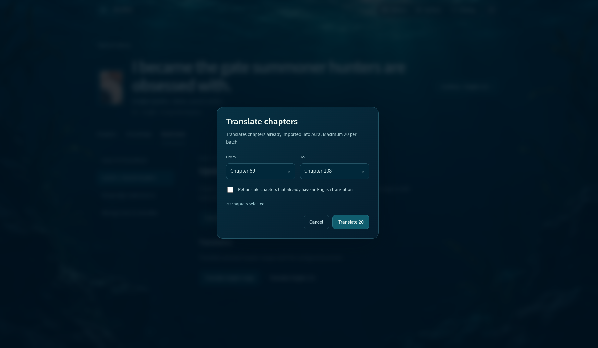
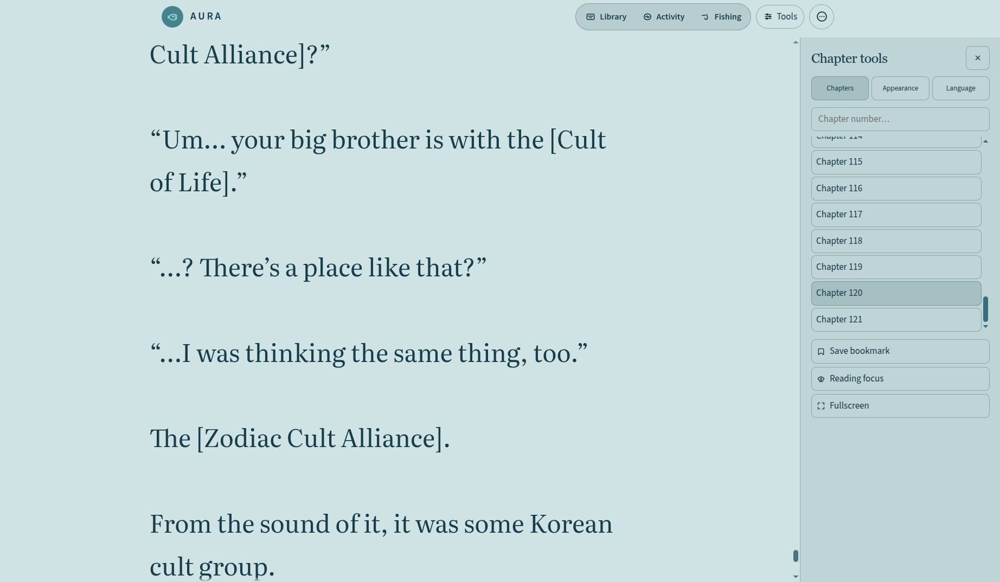
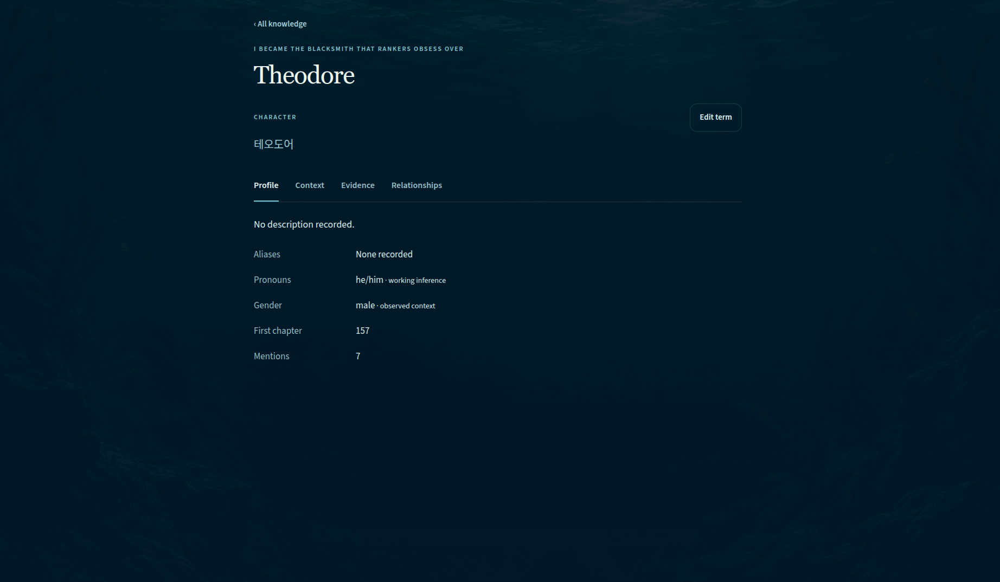
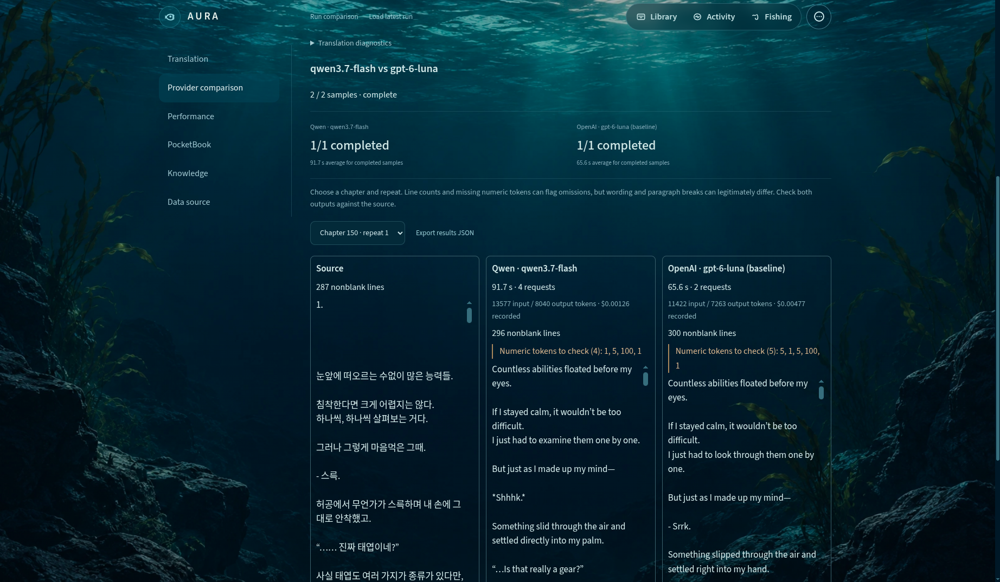
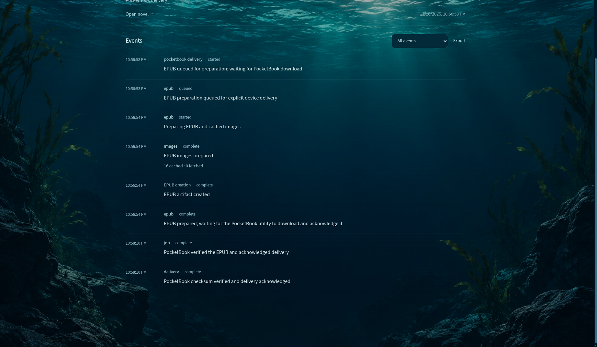

# Aura Translator · Product walkthrough

[Back to the project overview](../README.md)

Aura imports web novels, translates chapters in background jobs, and makes the results available in a web reader or as an EPUB. The screenshots below come from the running instance. Screenshots show separate workflows, including one recorded model comparison and one completed device delivery.

## Queue a chapter batch

Choose a range of imported chapters and decide whether to re-translate already translated sections. Once queued, the work is tracked in Activity Center. Aura saves completed translation sections so a resumed job can reuse them.

## Read the translation

Read the English text with chapter navigation and reader controls close at hand. The Language tab lets you switch to the original text. The Appearance tab controls typography and the reading theme.

## Inspect character context

Aura Intelligence keeps terminology and character information per novel. The profile below shows a Korean source name and its English rendering, the chapter where it first appeared, and pronoun guidance labeled as a working inference (best guess). Entries in Aura Intelligence are also checked in untranslated sections before translation and then reused to keep consistency between chapters.

## Compare translation models

Aura Developer Studio has LLM provider comparison tool. It shows the same source alongside both model outputs, with elapsed time, request count, token usage, recorded cost, and validation flags. The screenshot shows one paired run of Qwen3.7 Flash and GPT-6 Luna. 

## Deliver an EPUB to PocketBook

Aura builds an EPUB from the saved translations and prepares its images. The delivery timeline tracks the file until the PocketBook utility downloads it, verifies its checksum, and acknowledges receipt. The screenshot records a completed delivery.

